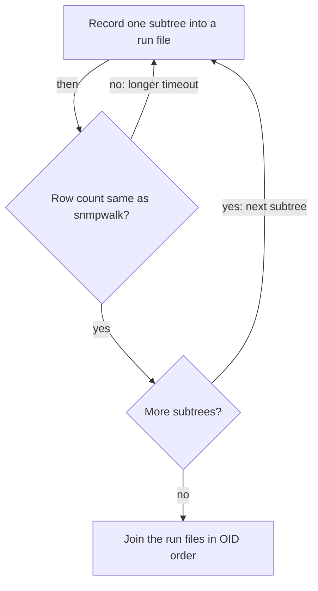
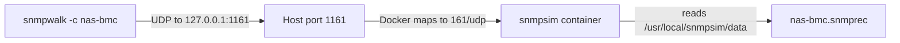

# SNMP test data reference

## Summary

This folder holds the Simple Network Management Protocol (SNMP) test data of the SNMP bridge. Each `.snmprec` file holds the sensor subtrees of one Target, recorded from the real device in the format of snmpsim. Tests and an snmpsim container use the files, so no test needs a real device.

This note is for a maintainer who adds or changes a test file. It does not describe the bridge code or the tests.

## File list

snmpsim uses the file name as the community. For example, the community `nas-bmc` gives the data of `nas-bmc.snmprec`.

| File | Device | Firmware | Recorded subtrees | Rows |
|---|---|---|---|---|
| `nas-bmc.snmprec` | Supermicro X10DRL-i board, baseboard management controller (BMC) | BMC firmware 03.91 | Vendor sensor table `1.3.6.1.4.1.21317.1.3.1` | 2600 |
| `cgw-fiber.snmprec` | UniFi Cloud Gateway Fiber (UCG-Fiber) | UniFi OS 5.1.35 | LM-SENSORS-MIB `1.3.6.1.4.1.2021.13.16`, UCD-SNMP-MIB central processing unit (CPU) `1.3.6.1.4.1.2021.11`, UCD-SNMP-MIB memory `1.3.6.1.4.1.2021.4` | 72 |
| `u6-plus.snmprec` | UniFi U6+ access point | UniFi firmware 6.7.54.15663 | HOST-RESOURCES-MIB `hrProcessorLoad` `1.3.6.1.2.1.25.3.3.1.2`, UCD-SNMP-MIB memory `1.3.6.1.4.1.2021.4` | 24 |
| `check.sh` | None | None | None | None |

The files hold only the subtrees in the table. They hold no full walk and no `system` object identifiers (OIDs), such as `sysName` or `sysDescr`. The repo is public, and a full walk holds names, serial numbers and addresses.

## Replaced OIDs

No row holds a host name, an address, a media access control (MAC) address or a serial number. So no value has a placeholder, and the list of replaced OIDs is empty.

When a new recording holds a private value, do these steps:

1. Replace the value with a placeholder of the same type, for example `redacted`. For a `4x` row, change the type to `4` and the value to `redacted`.
2. Keep the OID and the row.
3. Add the OID to this section.

## Requirements

You need these tools:

- `uv` and Python 3.11, for the recorder
- Docker, for the snmpsim container
- net-snmp `snmpwalk`, for the row count and the read check
- `xxd`, for `check.sh`

## Record a file

The recorder is `snmpsim-record-commands` from snmpsim 1.1.7 with pysnmp 6.2.6. snmpsim 1.2.2 with pysnmp 7 stops with `ValueError: too many values to unpack`.

This diagram shows the loop over the subtrees of one device. The numbered list below gives the same steps.



1. Install the recorder in a folder outside the repo, for example `/tmp`:

   ```sh
   cd /tmp
   uv venv -p 3.11 snmpsim-venv
   uv pip install -p snmpsim-venv "snmpsim<1.2"
   ```

2. Find the sensor subtrees of the device in its vendor MIB. Record only these subtrees.
3. Set `COMMUNITY` in the shell to the read community of the device. Do not write it in a file.
4. Record one subtree into a run file. For `--stop-object`, add 1 to the last number of the start OID. This is an example.

   ```sh
   timeout -s INT 150 snmpsim-venv/bin/snmpsim-record-commands --protocol-version 2c \
     --community "$COMMUNITY" --agent-udpv4-endpoint 192.0.2.10:161 \
     --start-object 1.3.6.1.4.1.2021.4 --stop-object 1.3.6.1.4.1.2021.5 \
     --output-file run-mem.snmprec
   ```

   The recorder 1.1.7 does not exit at the stop OID, but it writes no row after the stop OID. `timeout -s INT` stops the recorder. The SIGINT makes the recorder write the last rows. A stop with SIGTERM or SIGKILL loses the last rows. The recorder writes about 16 rows each second. Set the timeout to the row count divided by 16, plus 30 seconds.

5. Count the rows of the run file and of a direct walk of the same subtree. When the 2 counts are different, do step 4 again with a longer timeout:

   ```sh
   wc -l run-mem.snmprec
   snmpwalk -v2c -c "$COMMUNITY" -On 192.0.2.10 1.3.6.1.4.1.2021.4 | wc -l
   ```

6. Do steps 4 and 5 for each subtree of the device.
7. Join the run files of one device into one file, in OID order. A text sort gives the wrong order, so give the run files in order. For example, put `2021.4` before `2021.11`:

   ```sh
   cat run-mem.snmprec run-cpu.snmprec run-sensors.snmprec > cgw-fiber.snmprec
   ```

8. Give the file the name of the community for the snmpsim container. Move it into `internal/snmpbridge/testdata`.
9. Add a row for the file to the file list of this note.

## Check a file for private data

Run `check.sh` in `internal/snmpbridge/testdata`. Give each of these private strings as an argument:

- The homelab domain
- The host names
- Each community

The strings come only from the command line, never from a file in the repo.

```sh
./check.sh example.lan nas-host "$COMMUNITY"
```

The script checks the value of each row of each `.snmprec` file in the folder. It does not check the OIDs. It finds these values:

- An Internet Protocol version 4 (IPv4) address in `10.0.0.0/8`, `172.16.0.0/12` or `192.168.0.0/16`
- A MAC address as text, or a hex value (type `4x`) of 6 bytes that is not text
- Each private string, with no case match

The script also decodes the hex values (type `4x`) and checks the decoded text.

The script does not find a serial number. This command prints each text row with its hex value decoded. Read the output by hand for a serial number.

```sh
while IFS='|' read -r oid type value; do
  case "$type" in
    4) echo "$oid $value" ;;
    4x) echo "$oid $(printf '%s' "$value" | xxd -r -p | tr -c '[:print:]' .)" ;;
  esac
done < nas-bmc.snmprec
```

The script stops with one of these exit codes:

| Exit code | Meaning |
|---|---|
| 0 | No private data found |
| 1 | A finding. The output names the file. For a private string, it gives only the position of the argument. |
| 2 | No argument, an empty argument, no `.snmprec` file, or no `xxd` |

## Serve the files

This diagram shows the path of a read from `snmpwalk` to a file:



1. Start the snmpsim container in `internal/snmpbridge/testdata`. The container reads the files only at start. Restart it after you add or change a file.

   ```sh
   docker run -d --rm --name snmpsim -p 127.0.0.1:1161:161/udp \
     -v "$PWD:/usr/local/snmpsim/data:ro" \
     tandrup/snmpsim@sha256:5140279e9080b2053febf8676f6c338f3723b0d06be8b77cf7e4657876e5c17c
   ```

   The digest pins the image that served the 2 files in the read check of this note.

2. Read a Target with the file name as the community. For example:

   ```sh
   snmpwalk -v2c -c nas-bmc -On 127.0.0.1:1161 1.3.6.1.4.1.21317.1.3.1
   snmpwalk -v2c -c cgw-fiber -On 127.0.0.1:1161 1.3.6.1.4.1.2021
   ```

   The walk gives one line for each row of the file, for example `.1.3.6.1.4.1.2021.11.11.0 = INTEGER: 84`. The row counts are in the file list.

3. Stop the container:

   ```sh
   docker stop snmpsim
   ```

## Related

`GLOSSARY.md` at the repo root defines Target and Profile.
